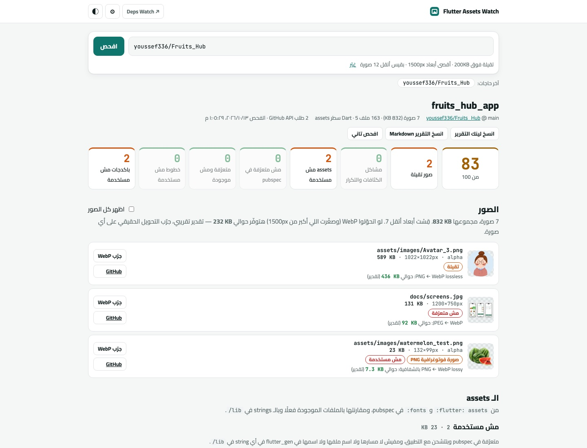

<h1 align="center">Flutter Assets Watch</h1>

<p align="center">
  Paste any Flutter repo from GitHub and see which images are too heavy, which assets, fonts and packages nobody uses, and where your APK size goes.
</p>

<p align="center">
  <a href="https://youssef336.github.io/flutter-assets-watch/"></a>
  
  
  
  
  
</p>

<p align="center">
  
  <br/><sub>Live site: scan of a real Flutter repo</sub>
</p>

> **English summary.** Flutter Assets Watch is a zero-backend, zero-build web tool (Arabic UI), the sibling of
> [Flutter Deps Watch](https://youssef336.github.io/flutter-deps-watch/). Give it a GitHub repo link and it reads the
> git tree (which already carries every file's byte size), `pubspec.yaml` and the Dart code in `lib/`, then reports:
> **heavy images** (over a size threshold, photographic PNGs, oversized pixel dimensions, missing / identical
> `2.0x`·`3.0x` density variants, exact duplicates) with an estimated WebP saving and a *real* in-browser WebP
> conversion you can download; **unused assets** (declared but never referenced by path, file name, constant or
> `flutter_gen` name; files present but not declared; declared but missing; unused font families); **unused
> dependencies** (nobody imports `package:name/`, with an allow-list for generators, lint sets, CLI tools, federated
> plugin implementations and native-only libraries); and an **APK / IPA size breakdown** from the JSON written by
> `flutter build apk --analyze-size` (squarified treemap with drill-down + top-20 table). Everything ends in a score,
> a shareable `?repo=owner/name` link and a one-click Markdown report for PRs. Plain ES modules, no dependencies,
> unit-tested in headless Chrome.

**🔗 الموقع:** https://youssef336.github.io/flutter-assets-watch/

<div dir="rtl">

حط لينك أي repo Flutter على GitHub، والصفحة تقولك ليه التطبيق تقيل: أنهي صور محتاجة تصغر أو تبقى WebP،
وأنهي assets وخطوط وباكدجات محدش بيستخدمها. وكمان ترمي ملف `--analyze-size` وتشوف الـ APK رايح فين.
كله بيشتغل في المتصفح: مفيش server، ولا تسجيل دخول، ولا build step.

## ✨ بيعمل إيه

- 🖼 **الصور التقيلة**: كل png / jpg / webp / gif في المشروع بحجمها (من شجرة git على طول، من غير ما ينزّلها).
  أتقل كام صورة بيقيس أبعادها جوه المتصفح، ويعلّم على:
  - أكبر من حد الـ KB اللي تحدده (الافتراضي 200KB).
  - PNG لصورة فوتوغرافية (ألوان كتير) — مكانها WebP أو JPEG.
  - أبعاد أكبر من اللي الموبايل محتاجه (الافتراضي 1500px).
  - ناقصها `2.0x` / `3.0x` وأخواتها في نفس الفولدر عندهم، أو فيه كثافات من غير الـ 1x، أو نسخة الكثافة هي هي الأصلية.
  - نفس الملف بالظبط متكرر في مكانين.
- 💾 **تقدير التوفير**: لكل صورة قد إيه ممكن توفّر لو بقت WebP (وصغّرتها لو كبيرة) — ومكتوب عليه إنه تقدير.
- 🔁 **«جرّب WebP» بجد**: بيحوّل الصورة في المتصفح بـ `canvas`، يوريك قبل وبعد والحجم الحقيقي، وتنزّلها على طول.
- 🧹 **الـ assets اللي مش مستخدمة**: بيقرا `flutter: assets:` و `fonts:`، ويدوّر في الـ strings بتاعة `lib/` على المسار
  أو اسم الملف أو اسم `flutter_gen` (`Assets.images.icLogo`). لو المسار متسجّل في constant محدش بيستخدمه بيعتبره مش مستخدم.
  وكمان: ملفات في فولدرات الـ assets ومش متعرّفة (تعريف الفولدر مش بيدخّل اللي جواه)، وسطور في pubspec بتشاور على حاجة
  مش موجودة، وخطوط متعرّفة ومحدش بيكتب اسمها.
- 📦 **الباكدجات اللي مش مستخدمة**: أي dependency مفيش ملف في `lib/` أو `bin/` أو `test/` بيعمله `import`، وأي حاجة
  مستخدمة في التستات بس. مولّدات الكود والـ lints وأدوات سطر الأوامر و plugins الـ federated و `flutter_localizations`
  مع `generate: true` بيتشرح سببها بدل ما تتعلّم غلط. وبيطلعلك أمر `flutter pub remove` جاهز.
- 📊 **حجم الـ APK**: ارمي ملف الـ JSON اللي بيطلّعه `flutter build apk --analyze-size` (أو appbundle أو ios)، وتشوف
  التقسيم (Dart، engine، native، assets، dex، resources) و treemap تدخل فيه بالضغط، وجدول بأكبر 20 حاجة.
- 🏁 **درجة من 100** وعدد كل مشكلة، و**لينك للتقرير** (`?repo=owner/name`) وزرار ينسخه Markdown عشان تحطه في PR.
- 🌗 وضع فاتح وغامق، والصفحة شغالة على الموبايل.

## 🔐 الـ Private repos والـ rate limit

من ⚙︎ حط GitHub token (fine-grained، وصلاحيته **Contents: Read-only** بس). الـ token بيروح لـ `api.github.com` وبس،
ومش بيتحفظ غير لو علّمت «افتكره» — ولو حفظته في Deps Watch بيشتغل هنا على طول. من غير token الـ repos العامة شغالة
عادي، بس GitHub بيسمح بـ 60 طلب API في الساعة، وكل فحص بياخد **2 بس** (الـ repo والشجرة)؛ ملفات Dart والصور بتيجي من
`raw.githubusercontent.com` اللي مش بيتحسب. مع token كل ملف بيبقى طلب API (والحد 5000).

## 📏 الحدود اللي تقدر تغيّرها

من ⚙︎: الصورة تبقى «تقيلة» فوق كام KB، وأقصى أبعاد معقولة، وتقيس أبعاد أتقل كام صورة.

## ⚖️ الحدود

- «مستخدم» معناها إن المسار أو الاسم ظاهر في الكود، مش إن الكود ده بيتنفّذ. ولو المسار بيتركّب من حتت
  (`'assets/icons/$name.svg'`) بيظهر في «يمكن مستخدمة» عشان تراجعه بإيدك.
- الصور المتخزّنة بـ Git LFS حجمها في الشجرة هو حجم الـ pointer.
- تقدير الـ WebP تقريبي؛ الرقم الحقيقي من زرار «جرّب WebP».
- أكتر من 3000 ملف Dart بيتقري أول 3000 بس، ولو GitHub قطع الشجرة (repos ضخمة جدًا) النتايج بتبقى ناقصة وبيقولك.

</div>

## 🛠 Tech stack

- Vanilla JavaScript (ES modules), HTML and CSS: no framework, no npm dependencies, no build step.
- GitHub REST (repo + one recursive tree call) and `raw.githubusercontent.com`, called straight from the browser.
- `createImageBitmap` + canvas for pixel facts and real WebP re-encoding; a hand-rolled squarified treemap.
- Hosted on GitHub Pages; tests run in headless Chrome via GitHub Actions.

## 🏗 Project structure

| File | Role |
|---|---|
| `js/pubspec.js` | tiny block-YAML reader + dependencies, `flutter: assets:` / `fonts:` |
| `js/images.js` | density variants, duplicates, photo heuristic, flags, WebP savings estimate |
| `js/assets.js` | declared vs. present vs. referenced assets, fonts, `flutter_gen` and constant aliases |
| `js/deps.js` | unused dependencies with an explained allow-list |
| `js/sizes.js`, `js/treemap.js`, `js/sizeview.js` | `--analyze-size` JSON, squarified layout, size panel |
| `js/report.js` | score and Markdown export |
| `js/scan.js`, `js/github.js` | one scan end to end, GitHub access |
| `js/pixels.js` | in-browser image inspection and WebP conversion |
| `js/main.js`, `js/labels.js`, `js/util.js` | page, Arabic strings, helpers |
| `tests/` | in-browser unit tests + a sample size JSON |
| `tool/test.sh` | runs the tests in headless Chrome |
| `tool/e2e.py` | real scan of a public repo in headless Chrome over CDP (stdlib only), fails on console errors |

## 🚀 Getting started

```bash
git clone https://github.com/youssef336/flutter-assets-watch.git
cd flutter-assets-watch
python3 -m http.server 8000                      # then open http://localhost:8000
bash tool/test.sh                                # unit tests in headless Chrome (set CHROME=... if not auto-detected)
python3 tool/e2e.py youssef336/Fruits_Hub --size-sample   # end-to-end against GitHub
```

## 📄 License

[MIT](LICENSE)

## 👤 Author

**Youssef Belal Zakaria** · [GitHub @youssef336](https://github.com/youssef336)

⭐ If you like this project, give it a star!
